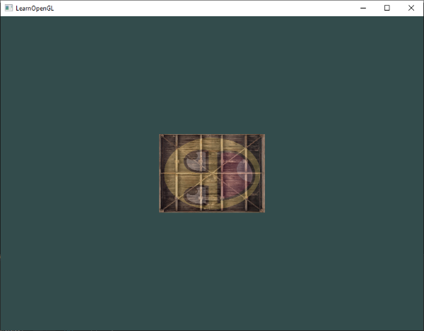
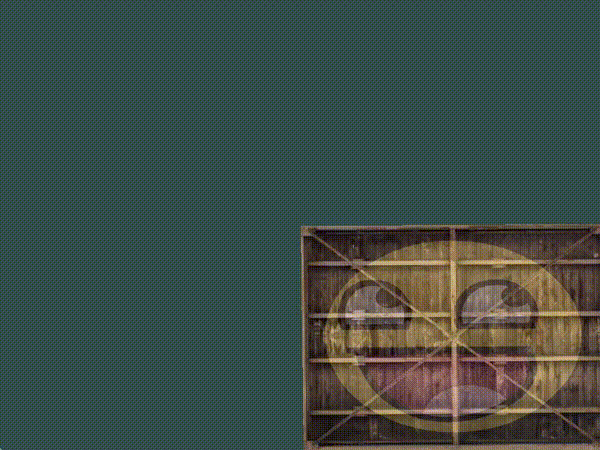

> LearnOpenGL CN 相关链接：<https://learnopengl-cn.github.io/01%20Getting%20started/07%20Transformations/>
{: .prompt-info }

> 本节视频：<https://www.bilibili.com/video/BV1ZGX1BxEdX?p=3>
{: .prompt-info }

## 使用到的素材（右键-将图像另存为）

<div style="display: flex; justify-content: space-between;">
    
    
</div>

> 文件为 [Joey de Vries](https://joeydevries.com/) 所有。所有权利均保留。
> All credit goes to [Joey de Vries](https://joeydevries.com/). All rights reserved.

## 本节代码（点击展开）

<details markdown="1">
<summary><b>箱子向左侧旋转，并是原来的一半大小</b></summary>



```py
# 导入需要的库
import glfw
import moderngl as mgl
import numpy as np
from PIL import Image
from pyglm import glm

# 初始化 GLFW
if not glfw.init():
    raise Exception('GLFW出错')

# 创建窗口
window = glfw.create_window(800, 600, 'LearnOpenGL', None, None)
if not window:
    glfw.terminate()
    raise Exception('window出错')

# 获得上下文
glfw.make_context_current(window)
ctx = mgl.create_context()

# 视口
def framebuffer_size_callback(window, width, height):
    ctx.viewport = (0, 0, width, height)

glfw.set_framebuffer_size_callback(window, framebuffer_size_callback)

# 处理输入
def process_input(window):
    if glfw.get_key(window, glfw.KEY_ESCAPE) == glfw.PRESS:
        glfw.set_window_should_close(window, True)

# 着色器程序
vertex_shader = '''
#version 330 core

in vec3 in_vert;
in vec2 in_texcoord;

out vec2 v_texcoord;

uniform mat4 transform;

void main()
{
    gl_Position = transform * vec4(in_vert, 1.0);
    v_texcoord = in_texcoord;
}
'''

fragment_shader = '''
#version 330 core

in vec2 v_texcoord;

uniform sampler2D texture1;
uniform sampler2D texture2;

out vec4 FragColor;

void main()
{
    FragColor = mix(texture(texture1, v_texcoord), texture(texture2, v_texcoord), 0.2);
}
'''

prog = ctx.program(vertex_shader, fragment_shader)

# 顶点数据
vertices = np.array([
#   ----- 位置 -----   - 纹理坐标 -
     0.5,  0.5, 0.0,  1.0, 1.0,   # 右上
     0.5, -0.5, 0.0,  1.0, 0.0,   # 右下
    -0.5, -0.5, 0.0,  0.0, 0.0,   # 左下
    -0.5,  0.5, 0.0,  0.0, 1.0    # 左上
], dtype='f4')

vbo = ctx.buffer(vertices.tobytes())

indices = np.array([
    0, 1, 3,    # 第一个三角形
    1, 2, 3     # 第二个三角形
], dtype='i4')

ibo = ctx.buffer(indices.tobytes())

# 顶点数组对象
vao = ctx.vertex_array(prog, vbo, 'in_vert', 'in_texcoord', index_buffer=ibo)

# 纹理
img = Image.open('container.jpg').transpose(Image.FLIP_TOP_BOTTOM)
texture1 = ctx.texture(img.size, components=3, data=img.tobytes())
img = Image.open('awesomeface.png').transpose(Image.FLIP_TOP_BOTTOM)
texture2 = ctx.texture(img.size, components=4, data=img.tobytes())

# 绑定纹理
prog['texture1'] = 0
prog['texture2'] = 1
texture1.use(0)
texture2.use(1)

# 矩阵
trans = glm.mat4(1)
trans = glm.rotate(trans, glm.radians(90), glm.vec3(0, 0, 1))
trans = glm.scale(trans, glm.vec3(0.5, 0.5, 0.5))

prog['transform'].write(trans.to_bytes())

# 渲染循环
while not glfw.window_should_close(window):
    # 输入
    process_input(window)

    # 渲染指令
    ctx.clear(0.2, 0.3, 0.3)
    vao.render(mgl.TRIANGLES)

    # 处理事件、交换缓冲
    glfw.poll_events()
    glfw.swap_buffers(window)

# 终止 GLFW
glfw.terminate()
```

</details>

<details markdown="1">
<summary><b>在画面的右下角不断旋转的箱子</b></summary>



```py
# 导入需要的库
import glfw
import moderngl as mgl
import numpy as np
from PIL import Image
from pyglm import glm

# 初始化 GLFW
if not glfw.init():
    raise Exception('GLFW出错')

# 创建窗口
window = glfw.create_window(800, 600, 'LearnOpenGL', None, None)
if not window:
    glfw.terminate()
    raise Exception('window出错')

# 获得上下文
glfw.make_context_current(window)
ctx = mgl.create_context()

# 视口
def framebuffer_size_callback(window, width, height):
    ctx.viewport = (0, 0, width, height)

glfw.set_framebuffer_size_callback(window, framebuffer_size_callback)

# 处理输入
def process_input(window):
    if glfw.get_key(window, glfw.KEY_ESCAPE) == glfw.PRESS:
        glfw.set_window_should_close(window, True)

# 着色器程序
vertex_shader = '''
#version 330 core

in vec3 in_vert;
in vec2 in_texcoord;

out vec2 v_texcoord;

uniform mat4 transform;

void main()
{
    gl_Position = transform * vec4(in_vert, 1.0);
    v_texcoord = in_texcoord;
}
'''

fragment_shader = '''
#version 330 core

in vec2 v_texcoord;

uniform sampler2D texture1;
uniform sampler2D texture2;

out vec4 FragColor;

void main()
{
    FragColor = mix(texture(texture1, v_texcoord), texture(texture2, v_texcoord), 0.2);
}
'''

prog = ctx.program(vertex_shader, fragment_shader)

# 顶点数据
vertices = np.array([
#   ----- 位置 -----   - 纹理坐标 -
     0.5,  0.5, 0.0,  1.0, 1.0,   # 右上
     0.5, -0.5, 0.0,  1.0, 0.0,   # 右下
    -0.5, -0.5, 0.0,  0.0, 0.0,   # 左下
    -0.5,  0.5, 0.0,  0.0, 1.0    # 左上
], dtype='f4')

vbo = ctx.buffer(vertices.tobytes())

indices = np.array([
    0, 1, 3,    # 第一个三角形
    1, 2, 3     # 第二个三角形
], dtype='i4')

ibo = ctx.buffer(indices.tobytes())

# 顶点数组对象
vao = ctx.vertex_array(prog, vbo, 'in_vert', 'in_texcoord', index_buffer=ibo)

# 纹理
img = Image.open('container.jpg').transpose(Image.FLIP_TOP_BOTTOM)
texture1 = ctx.texture(img.size, components=3, data=img.tobytes())
img = Image.open('awesomeface.png').transpose(Image.FLIP_TOP_BOTTOM)
texture2 = ctx.texture(img.size, components=4, data=img.tobytes())

# 绑定纹理
prog['texture1'] = 0
prog['texture2'] = 1
texture1.use(0)
texture2.use(1)

# 渲染循环
while not glfw.window_should_close(window):
    # 输入
    process_input(window)

    # 矩阵
    trans = glm.mat4(1)
    trans = glm.translate(trans, glm.vec3(0.5, -0.5, 0))
    trans = glm.rotate(trans, glfw.get_time(), glm.vec3(0, 0, 1))
    prog['transform'].write(trans.to_bytes())

    # 渲染指令
    ctx.clear(0.2, 0.3, 0.3)
    vao.render(mgl.TRIANGLES)

    # 处理事件、交换缓冲
    glfw.poll_events()
    glfw.swap_buffers(window)

# 终止 GLFW
glfw.terminate()
```

</details>
