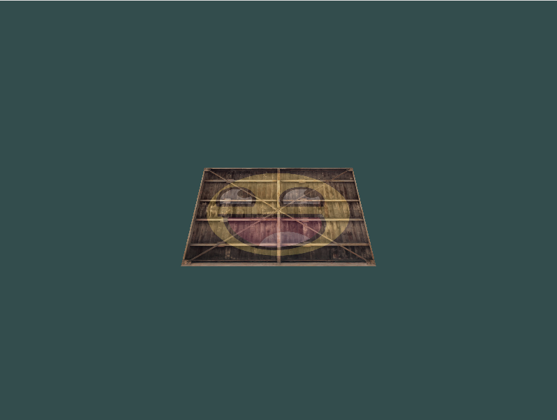
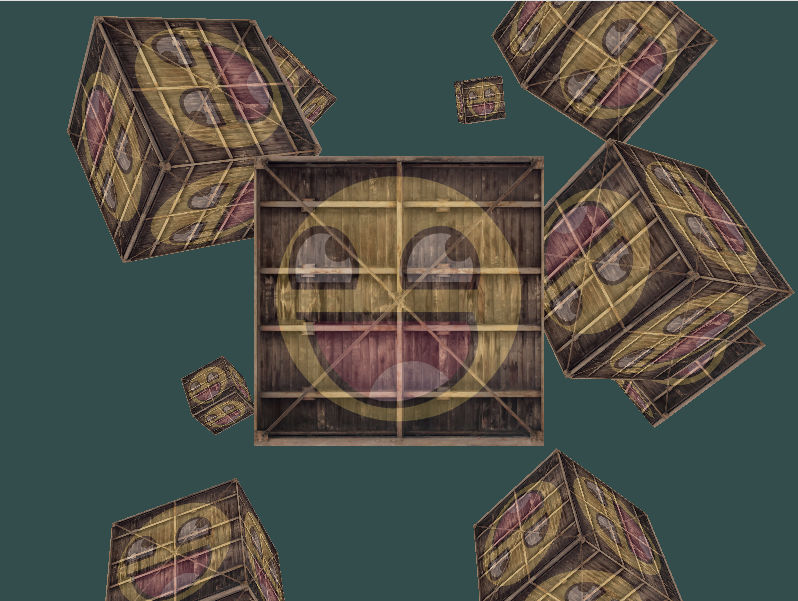

> LearnOpenGL CN 相关链接：<https://learnopengl-cn.github.io/01%20Getting%20started/08%20Coordinate%20Systems/>
{: .prompt-info }

> 本节视频：TODO
{: .prompt-info }

## 使用到的素材（右键-将图像另存为）

<div style="display: flex; justify-content: space-between;">
    
    
</div>

> 文件为 [Joey de Vries](https://joeydevries.com/) 所有。所有权利均保留。
> All credit goes to [Joey de Vries](https://joeydevries.com/). All rights reserved.

## 本节代码（点击展开）

<details markdown="1">
<summary><b>倒下去的箱子的一面</b></summary>



```py
# 导入需要的库
import glfw
import moderngl as mgl
import numpy as np
from PIL import Image
from pyglm import glm

# 初始化 GLFW
if not glfw.init():
    raise Exception('GLFW出错')

screenWidth = 800
screenHeight = 600

# 创建窗口
window = glfw.create_window(screenWidth, screenHeight, 'LearnOpenGL', None, None)
if not window:
    glfw.terminate()
    raise Exception('window出错')

# 获得上下文
glfw.make_context_current(window)
ctx = mgl.create_context()

# 视口
def framebuffer_size_callback(window, width, height):
    ctx.viewport = (0, 0, width, height)

glfw.set_framebuffer_size_callback(window, framebuffer_size_callback)

# 处理输入
def process_input(window):
    if glfw.get_key(window, glfw.KEY_ESCAPE) == glfw.PRESS:
        glfw.set_window_should_close(window, True)

# 着色器程序
vertex_shader = '''
#version 330 core

in vec3 in_vert;
in vec2 in_texcoord;

out vec2 v_texcoord;

uniform mat4 model;
uniform mat4 view;
uniform mat4 projection;

void main()
{
    // 注意乘法要从右向左读
    gl_Position = projection * view * model * vec4(in_vert, 1.0);
    v_texcoord = in_texcoord;
}
'''

fragment_shader = '''
#version 330 core

in vec2 v_texcoord;

uniform sampler2D texture1;
uniform sampler2D texture2;

out vec4 FragColor;

void main()
{
    FragColor = mix(texture(texture1, v_texcoord), texture(texture2, v_texcoord), 0.2);
}
'''

prog = ctx.program(vertex_shader, fragment_shader)

# 顶点数据
vertices = np.array([
#   ----- 位置 -----   - 纹理坐标 -
     0.5,  0.5, 0.0,  1.0, 1.0,   # 右上
     0.5, -0.5, 0.0,  1.0, 0.0,   # 右下
    -0.5, -0.5, 0.0,  0.0, 0.0,   # 左下
    -0.5,  0.5, 0.0,  0.0, 1.0    # 左上
], dtype='f4')

vbo = ctx.buffer(vertices.tobytes())

indices = np.array([
    0, 1, 3,    # 第一个三角形
    1, 2, 3     # 第二个三角形
], dtype='i4')

ibo = ctx.buffer(indices.tobytes())

# 顶点数组对象
vao = ctx.vertex_array(prog, vbo, 'in_vert', 'in_texcoord', index_buffer=ibo)

# 纹理
img = Image.open('container.jpg').transpose(Image.FLIP_TOP_BOTTOM)
texture1 = ctx.texture(img.size, components=3, data=img.tobytes())
img = Image.open('awesomeface.png').transpose(Image.FLIP_TOP_BOTTOM)
texture2 = ctx.texture(img.size, components=4, data=img.tobytes())

# 绑定纹理
prog['texture1'] = 0
prog['texture2'] = 1
texture1.use(0)
texture2.use(1)

# 渲染循环
while not glfw.window_should_close(window):
    # 输入
    process_input(window)

    # 模型矩阵 
    model = glm.mat4(1)
    model = glm.rotate(model, glm.radians(-55.0), glm.vec3(1.0, 0.0, 0.0))

    # 观察矩阵 
    view = glm.mat4(1)
    # 注意，这里朝着我们期望移动的相反方向移动场景
    view = glm.translate(view, glm.vec3(0.0, 0.0, -3.0))

    # 透视矩阵
    projection = glm.mat4(1)
    projection = glm.perspective(glm.radians(45.0), screenWidth / screenHeight, 0.1, 100.0)

    prog['model'].write(model.to_bytes())
    prog['view'].write(view.to_bytes())
    prog['projection'].write(projection.to_bytes())

    # 渲染指令
    ctx.clear(0.2, 0.3, 0.3)
    vao.render(mgl.TRIANGLES)

    # 处理事件、交换缓冲
    glfw.poll_events()
    glfw.swap_buffers(window)

# 终止 GLFW
glfw.terminate()
```

</details>

<details markdown="1">
<summary><b>立方体的 36 个顶点的数据</b></summary>

```py
# 顶点数据
vertices = np.array([
#   ----- 位置 -----   - 纹理坐标 -
    -0.5, -0.5, -0.5,  0.0, 0.0,
     0.5, -0.5, -0.5,  1.0, 0.0,
     0.5,  0.5, -0.5,  1.0, 1.0,
     0.5,  0.5, -0.5,  1.0, 1.0,
    -0.5,  0.5, -0.5,  0.0, 1.0,
    -0.5, -0.5, -0.5,  0.0, 0.0,

    -0.5, -0.5,  0.5,  0.0, 0.0,
     0.5, -0.5,  0.5,  1.0, 0.0,
     0.5,  0.5,  0.5,  1.0, 1.0,
     0.5,  0.5,  0.5,  1.0, 1.0,
    -0.5,  0.5,  0.5,  0.0, 1.0,
    -0.5, -0.5,  0.5,  0.0, 0.0,

    -0.5,  0.5,  0.5,  1.0, 0.0,
    -0.5,  0.5, -0.5,  1.0, 1.0,
    -0.5, -0.5, -0.5,  0.0, 1.0,
    -0.5, -0.5, -0.5,  0.0, 1.0,
    -0.5, -0.5,  0.5,  0.0, 0.0,
    -0.5,  0.5,  0.5,  1.0, 0.0,

     0.5,  0.5,  0.5,  1.0, 0.0,
     0.5,  0.5, -0.5,  1.0, 1.0,
     0.5, -0.5, -0.5,  0.0, 1.0,
     0.5, -0.5, -0.5,  0.0, 1.0,
     0.5, -0.5,  0.5,  0.0, 0.0,
     0.5,  0.5,  0.5,  1.0, 0.0,

    -0.5, -0.5, -0.5,  0.0, 1.0,
     0.5, -0.5, -0.5,  1.0, 1.0,
     0.5, -0.5,  0.5,  1.0, 0.0,
     0.5, -0.5,  0.5,  1.0, 0.0,
    -0.5, -0.5,  0.5,  0.0, 0.0,
    -0.5, -0.5, -0.5,  0.0, 1.0,

    -0.5,  0.5, -0.5,  0.0, 1.0,
     0.5,  0.5, -0.5,  1.0, 1.0,
     0.5,  0.5,  0.5,  1.0, 0.0,
     0.5,  0.5,  0.5,  1.0, 0.0,
    -0.5,  0.5,  0.5,  0.0, 0.0,
    -0.5,  0.5, -0.5,  0.0, 1.0,
], dtype='f4')
```
```
```

</details>

<details markdown="1">
<summary><b>旋转的箱子</b></summary>


```py
# 导入需要的库
import glfw
import moderngl as mgl
import numpy as np
from PIL import Image
from pyglm import glm

# 初始化 GLFW
if not glfw.init():
    raise Exception('GLFW出错')

screenWidth = 800
screenHeight = 600

# 创建窗口
window = glfw.create_window(screenWidth, screenHeight, 'LearnOpenGL', None, None)
if not window:
    glfw.terminate()
    raise Exception('window出错')

# 获得上下文
glfw.make_context_current(window)
ctx = mgl.create_context()

# 视口
def framebuffer_size_callback(window, width, height):
    ctx.viewport = (0, 0, width, height)

glfw.set_framebuffer_size_callback(window, framebuffer_size_callback)

# 处理输入
def process_input(window):
    if glfw.get_key(window, glfw.KEY_ESCAPE) == glfw.PRESS:
        glfw.set_window_should_close(window, True)

# 着色器程序
vertex_shader = '''
#version 330 core

in vec3 in_vert;
in vec2 in_texcoord;

out vec2 v_texcoord;

uniform mat4 model;
uniform mat4 view;
uniform mat4 projection;

void main()
{
    // 注意乘法要从右向左读
    gl_Position = projection * view * model * vec4(in_vert, 1.0);
    v_texcoord = in_texcoord;
}
'''

fragment_shader = '''
#version 330 core

in vec2 v_texcoord;

uniform sampler2D texture1;
uniform sampler2D texture2;

out vec4 FragColor;

void main()
{
    FragColor = mix(texture(texture1, v_texcoord), texture(texture2, v_texcoord), 0.2);
}
'''

prog = ctx.program(vertex_shader, fragment_shader)

# 顶点数据
vertices = np.array([
#   ----- 位置 -----   - 纹理坐标 -
    -0.5, -0.5, -0.5,  0.0, 0.0,
     0.5, -0.5, -0.5,  1.0, 0.0,
     0.5,  0.5, -0.5,  1.0, 1.0,
     0.5,  0.5, -0.5,  1.0, 1.0,
    -0.5,  0.5, -0.5,  0.0, 1.0,
    -0.5, -0.5, -0.5,  0.0, 0.0,

    -0.5, -0.5,  0.5,  0.0, 0.0,
     0.5, -0.5,  0.5,  1.0, 0.0,
     0.5,  0.5,  0.5,  1.0, 1.0,
     0.5,  0.5,  0.5,  1.0, 1.0,
    -0.5,  0.5,  0.5,  0.0, 1.0,
    -0.5, -0.5,  0.5,  0.0, 0.0,

    -0.5,  0.5,  0.5,  1.0, 0.0,
    -0.5,  0.5, -0.5,  1.0, 1.0,
    -0.5, -0.5, -0.5,  0.0, 1.0,
    -0.5, -0.5, -0.5,  0.0, 1.0,
    -0.5, -0.5,  0.5,  0.0, 0.0,
    -0.5,  0.5,  0.5,  1.0, 0.0,

     0.5,  0.5,  0.5,  1.0, 0.0,
     0.5,  0.5, -0.5,  1.0, 1.0,
     0.5, -0.5, -0.5,  0.0, 1.0,
     0.5, -0.5, -0.5,  0.0, 1.0,
     0.5, -0.5,  0.5,  0.0, 0.0,
     0.5,  0.5,  0.5,  1.0, 0.0,

    -0.5, -0.5, -0.5,  0.0, 1.0,
     0.5, -0.5, -0.5,  1.0, 1.0,
     0.5, -0.5,  0.5,  1.0, 0.0,
     0.5, -0.5,  0.5,  1.0, 0.0,
    -0.5, -0.5,  0.5,  0.0, 0.0,
    -0.5, -0.5, -0.5,  0.0, 1.0,

    -0.5,  0.5, -0.5,  0.0, 1.0,
     0.5,  0.5, -0.5,  1.0, 1.0,
     0.5,  0.5,  0.5,  1.0, 0.0,
     0.5,  0.5,  0.5,  1.0, 0.0,
    -0.5,  0.5,  0.5,  0.0, 0.0,
    -0.5,  0.5, -0.5,  0.0, 1.0,
], dtype='f4')

vbo = ctx.buffer(vertices.tobytes())

# 顶点数组对象
vao = ctx.vertex_array(prog, vbo, 'in_vert', 'in_texcoord')

# 纹理
img = Image.open('container.jpg').transpose(Image.FLIP_TOP_BOTTOM)
texture1 = ctx.texture(img.size, components=3, data=img.tobytes())
img = Image.open('awesomeface.png').transpose(Image.FLIP_TOP_BOTTOM)
texture2 = ctx.texture(img.size, components=4, data=img.tobytes())

# 绑定纹理
prog['texture1'] = 0
prog['texture2'] = 1
texture1.use(0)
texture2.use(1)

ctx.enable(mgl.DEPTH_TEST)

# 渲染循环
while not glfw.window_should_close(window):
    # 输入
    process_input(window)

    # 模型矩阵
    model = glm.mat4(1)
    model = glm.rotate(model, glfw.get_time(), glm.vec3(0.5, 1.0, 0.0))

    # 观察矩阵 
    view = glm.mat4(1)
    # 注意，这里朝着我们期望移动的相反方向移动场景
    view = glm.translate(view, glm.vec3(0.0, 0.0, -3.0))

    # 透视矩阵
    projection = glm.mat4(1)
    projection = glm.perspective(glm.radians(45.0), screenWidth / screenHeight, 0.1, 100.0)

    prog['model'].write(model.to_bytes())
    prog['view'].write(view.to_bytes())
    prog['projection'].write(projection.to_bytes())

    # 渲染指令
    ctx.clear(0.2, 0.3, 0.3)
    vao.render(mgl.TRIANGLES)

    # 处理事件、交换缓冲
    glfw.poll_events()
    glfw.swap_buffers(window)

# 终止 GLFW
glfw.terminate()
```


</details>

<details markdown="1">
<summary><b>许多箱子</b></summary>



```py
# 导入需要的库
import glfw
import moderngl as mgl
import numpy as np
from PIL import Image
from pyglm import glm

# 初始化 GLFW
if not glfw.init():
    raise Exception('GLFW出错')

screenWidth = 800
screenHeight = 600

# 创建窗口
window = glfw.create_window(screenWidth, screenHeight, 'LearnOpenGL', None, None)
if not window:
    glfw.terminate()
    raise Exception('window出错')

# 获得上下文
glfw.make_context_current(window)
ctx = mgl.create_context()

# 视口
def framebuffer_size_callback(window, width, height):
    ctx.viewport = (0, 0, width, height)

glfw.set_framebuffer_size_callback(window, framebuffer_size_callback)

# 处理输入
def process_input(window):
    if glfw.get_key(window, glfw.KEY_ESCAPE) == glfw.PRESS:
        glfw.set_window_should_close(window, True)

# 着色器程序
vertex_shader = '''
#version 330 core

in vec3 in_vert;
in vec2 in_texcoord;

out vec2 v_texcoord;

uniform mat4 model;
uniform mat4 view;
uniform mat4 projection;

void main()
{
    // 注意乘法要从右向左读
    gl_Position = projection * view * model * vec4(in_vert, 1.0);
    v_texcoord = in_texcoord;
}
'''

fragment_shader = '''
#version 330 core

in vec2 v_texcoord;

uniform sampler2D texture1;
uniform sampler2D texture2;

out vec4 FragColor;

void main()
{
    FragColor = mix(texture(texture1, v_texcoord), texture(texture2, v_texcoord), 0.2);
}
'''

prog = ctx.program(vertex_shader, fragment_shader)

# 顶点数据
vertices = np.array([
#   ----- 位置 -----   - 纹理坐标 -
    -0.5, -0.5, -0.5,  0.0, 0.0,
     0.5, -0.5, -0.5,  1.0, 0.0,
     0.5,  0.5, -0.5,  1.0, 1.0,
     0.5,  0.5, -0.5,  1.0, 1.0,
    -0.5,  0.5, -0.5,  0.0, 1.0,
    -0.5, -0.5, -0.5,  0.0, 0.0,

    -0.5, -0.5,  0.5,  0.0, 0.0,
     0.5, -0.5,  0.5,  1.0, 0.0,
     0.5,  0.5,  0.5,  1.0, 1.0,
     0.5,  0.5,  0.5,  1.0, 1.0,
    -0.5,  0.5,  0.5,  0.0, 1.0,
    -0.5, -0.5,  0.5,  0.0, 0.0,

    -0.5,  0.5,  0.5,  1.0, 0.0,
    -0.5,  0.5, -0.5,  1.0, 1.0,
    -0.5, -0.5, -0.5,  0.0, 1.0,
    -0.5, -0.5, -0.5,  0.0, 1.0,
    -0.5, -0.5,  0.5,  0.0, 0.0,
    -0.5,  0.5,  0.5,  1.0, 0.0,

     0.5,  0.5,  0.5,  1.0, 0.0,
     0.5,  0.5, -0.5,  1.0, 1.0,
     0.5, -0.5, -0.5,  0.0, 1.0,
     0.5, -0.5, -0.5,  0.0, 1.0,
     0.5, -0.5,  0.5,  0.0, 0.0,
     0.5,  0.5,  0.5,  1.0, 0.0,

    -0.5, -0.5, -0.5,  0.0, 1.0,
     0.5, -0.5, -0.5,  1.0, 1.0,
     0.5, -0.5,  0.5,  1.0, 0.0,
     0.5, -0.5,  0.5,  1.0, 0.0,
    -0.5, -0.5,  0.5,  0.0, 0.0,
    -0.5, -0.5, -0.5,  0.0, 1.0,

    -0.5,  0.5, -0.5,  0.0, 1.0,
     0.5,  0.5, -0.5,  1.0, 1.0,
     0.5,  0.5,  0.5,  1.0, 0.0,
     0.5,  0.5,  0.5,  1.0, 0.0,
    -0.5,  0.5,  0.5,  0.0, 0.0,
    -0.5,  0.5, -0.5,  0.0, 1.0,
], dtype='f4')

vbo = ctx.buffer(vertices.tobytes())

# 顶点数组对象
vao = ctx.vertex_array(prog, vbo, 'in_vert', 'in_texcoord')

# 纹理
img = Image.open('container.jpg').transpose(Image.FLIP_TOP_BOTTOM)
texture1 = ctx.texture(img.size, components=3, data=img.tobytes())
img = Image.open('awesomeface.png').transpose(Image.FLIP_TOP_BOTTOM)
texture2 = ctx.texture(img.size, components=4, data=img.tobytes())

# 绑定纹理
prog['texture1'] = 0
prog['texture2'] = 1
texture1.use(0)
texture2.use(1)

ctx.enable(mgl.DEPTH_TEST)

cube_positions = [
    glm.vec3( 0.0,  0.0,  0.0), 
    glm.vec3( 2.0,  5.0, -15.0), 
    glm.vec3(-1.5, -2.2, -2.5),  
    glm.vec3(-3.8, -2.0, -12.3),  
    glm.vec3( 2.4, -0.4, -3.5),  
    glm.vec3(-1.7,  3.0, -7.5),  
    glm.vec3( 1.3, -2.0, -2.5),  
    glm.vec3( 1.5,  2.0, -2.5), 
    glm.vec3( 1.5,  0.2, -1.5), 
    glm.vec3(-1.3,  1.0, -1.5),
]

# 渲染循环
while not glfw.window_should_close(window):
    # 输入
    process_input(window)

    view = glm.mat4(1)
    view = glm.translate(view, glm.vec3(0.0, 0.0, -3.0))

    projection = glm.mat4(1)
    projection = glm.perspective(glm.radians(45.0), screenWidth / screenHeight, 0.1, 100.0)

    prog['view'].write(view.to_bytes())
    prog['projection'].write(projection.to_bytes())

    ctx.clear(0.2, 0.3, 0.3)

    for i, pos in enumerate(cube_positions):
        # 模型矩阵
        model = glm.mat4(1)
        model = glm.translate(model, pos)
        angle = 20 * i
        model = glm.rotate(model, glm.radians(angle), glm.vec3(1.0, 0.3, 0.5))

        prog['model'].write(model.to_bytes())

        vao.render(mgl.TRIANGLES)

    # 处理事件、交换缓冲
    glfw.poll_events()
    glfw.swap_buffers(window)

# 终止 GLFW
glfw.terminate()
```
```
```


</details>
